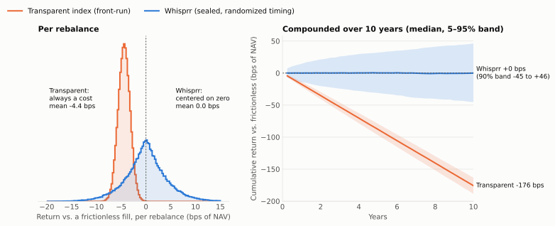
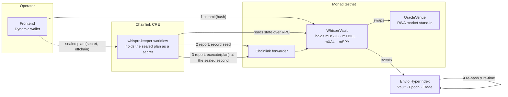

# Whisprr

**An onchain index whose rebalances can't be front-run.** Monad Metropolis Hackathon, Track 01: Onchain Finance & Trading.

The rules are public. The weights, and the exact second the rebalance executes, stay sealed until it happens, and that second is fixed by data nobody controls. Nobody can trade ahead of a rebalance they can't see, and nobody, operator included, gets to pick when it runs.

## The problem: index funds pay to be predictable

An index publishes its reconstitution rules and rebalances on a known date. Everyone knows what it must buy and sell, and when, so the market positions ahead of it:

- **Dimensional** finds that index additions rise ~9 bps between the reconstitution announcement and the close as the index is forced to buy, then reverse ~13 bps afterwards. That round trip is paid by the index.
- **Arnott et al. (via Alpha Architect)** estimate that trading ahead of index funds, or delaying reconstitution by 3–12 months, can add up to **23 bps a year**. Discretionary deletions beat additions by 22% on average in the year after changes.
- **Greenwood, "The Disappearing Index Effect" (Harvard)** shows the effect has shrunk as markets adapted. Whisprr doesn't depend on it staying large: it removes the predictability that creates it.

## The fix: seal the specifics, randomize the timing, take execution out of the operator's hands

Whisprr keeps **the framework public** and **the actionable detail sealed**:

| Public from day one ([`docs/FRAMEWORK.md`](docs/FRAMEWORK.md), hash stored onchain) | Sealed until the moment of execution |
|---|---|
| The universe of constituents, the methodology class, the execution window around each nominal date, the timing formula, the executor (Chainlink), the tolerances, the operator | The target weights, the trade list, the salt, and with it the exact execution second |

Each rebalance goes through four steps:

1. **Commit (operator).** The operator posts `keccak256(abi.encode(chainid, vault, epoch, weights, trades, salt))` and a nominal date, which fixes a public window `[nominal − jitterBefore, nominal + jitterAfter]`. The plan includes a random **salt**. The operator hands the sealed plan to the Chainlink CRE keeper workflow as a secret; it never touches the chain. **The operator's role ends here.**
2. **Seed (Monad).** Five blocks later, that block's hash is recorded onchain (by the keeper, or by anyone). From that moment the execution second is fixed:

   `executeAt = windowStart + keccak256(salt, seedHash) mod (window length + 1)`

   The salt was locked inside the commitment before the block existed, and nobody knew the block hash at commit time, so nobody chose the second. Without the salt, nobody can compute it: the market sees only the window.
3. **Execute (Chainlink only).** When the second arrives, the keeper delivers an `EXECUTE` report through the Chainlink forwarder. In **one transaction** the vault checks the plan against the commitment, recomputes `executeAt` from the revealed salt and requires `executeAt ≤ now ≤ executeAt + tolerance`, executes every trade against tokenized RWA constituents, and checks the resulting weights. The market learns the time and the trades in the same transaction. The operator has **no function to execute with**.
4. **Verify, or default.** Anyone can recompute both the hash and the execution second from the `Executed` event; the frontend and the Envio indexer both do so independently. If nothing executes by the end of the window plus the tolerance, anyone can flag the rebalance as defaulted onchain.

| Who | Can | Can't |
|---|---|---|
| Operator | Choose the target weights and the nominal date | Choose the execution second, execute, delay, or execute late |
| Chainlink keeper | Execute the committed plan at the sealed second | Execute a different plan (hash check) or at a different second (vault recomputes it) |
| Market | See the window and the commitment | Learn the second or the trades before they happen |

There's no ZK here. A hash commitment is the right primitive: the plan only needs to stay secret until it executes, not forever. One primitive covers every use: the public framework is committed by hash at deployment, each rebalance by hash before it executes, and the execution second is derived from what that hash locks in.

### The jitter isn't a cost

Randomizing the date means filling at a slightly different price than the nominal date would have given. That difference is **zero-mean noise**: as likely to help as to hurt. Front-running drag is **one-directional**: it bleeds against the index on every rebalance.

<picture>
  <source media="(prefers-color-scheme: dark)" srcset="analysis/dispersion-dark.svg">
  
</picture>

Monte Carlo, 100,000 rebalances ([`analysis/dispersion.py`](analysis/dispersion.py)). Assumptions: 4 rebalances a year, 20% turnover each, a front-running premium of 22 ± 6 bps on traded notional (Dimensional's run-up plus reversal), Whisprr fills at a uniform offset of −1 to +2 days, 150 bps daily idiosyncratic volatility, 40 names per rebalance. Under those assumptions the transparent index loses **~17.6 bps a year**, in line with Arnott's 23 bps. Whisprr's expected cost is **zero**.

## Live on Monad testnet

| Contract | Address |
|---|---|
| `WhisprrVault` | [`0x1CD04ce821C851Af7f28284E1f5FDBac9645d08C`](https://testnet.monadexplorer.com/address/0x1CD04ce821C851Af7f28284E1f5FDBac9645d08C) |
| `OracleVenue` | [`0xb8E8C1C7B0431b6D69Dd20444E763ab1B1D1F051`](https://testnet.monadexplorer.com/address/0xb8E8C1C7B0431b6D69Dd20444E763ab1B1D1F051) |
| mUSDC · mTBILL · mXAU · mSPY | [`0x5028…0dc5`](https://testnet.monadexplorer.com/address/0x502822f4238e792330Da841c192E194629B80dc5) · [`0x1B71…e608`](https://testnet.monadexplorer.com/address/0x1B71434Ae7e942568461D84eC6Ab065CE75ee608) · [`0x1A10…0F24`](https://testnet.monadexplorer.com/address/0x1A1093E67796c63745b447b8B138cBfB46BC0F24) · [`0xdF20…1989`](https://testnet.monadexplorer.com/address/0xdF2010a3c071236D50904AbD0c9a8DEA7b181989) |
| Chainlink forwarder (Monad testnet, simulation) | [`0xB9F79d863261869B234c481D1f9A7af84AeAd192`](https://testnet.monadexplorer.com/address/0xB9F79d863261869B234c481D1f9A7af84AeAd192) |

**Rebalance #3**, committed from the browser through Dynamic, executed by the Chainlink keeper (10/40/20/30 → 25/25/25/25):

| Step | Who | Transaction |
|---|---|---|
| 1. Commit: only the hash goes onchain | Operator (browser) | [`0x505f8b65…23b95c4d`](https://testnet.monadexplorer.com/tx/0x505f8b65e36b7e3c0d7d6826c6548b4b687c90c93a0b3c76ffe9c11823b95c4d) |
| 2. Seed: Monad block hash recorded; the second is now fixed but sealed | Chainlink keeper | [`0x67998ab2…7e6d1019`](https://testnet.monadexplorer.com/tx/0x67998ab2a89a0bc878a21285a0f327e816a0d2e13ab373453b02cf237e6d1019) |
| 3. Reveal + execute at the sealed second (+11 s) | Chainlink keeper | [`0xbfaf0084…b3f17beb`](https://testnet.monadexplorer.com/tx/0xbfaf00844a88fc89e34c3ec4689287a17e7c8116cb8851471b6d8584b3f17beb) |

**Rebalance #1** (command line, 25/25/25/25 → 10/40/20/30): commit [`0x1b4f939f…d6412375`](https://testnet.monadexplorer.com/tx/0x1b4f939f043fefec4be520360657f6346d3728c02d7bbd35898c1c5fd6412375), seed [`0xa3d39f73…1820c087`](https://testnet.monadexplorer.com/tx/0xa3d39f738d231ee474cff92ea92fc4fecd23dfc897b7c44dbda583b01820c087), executed at the sealed second +36 s [`0x4e0b26e5…ed327b12`](https://testnet.monadexplorer.com/tx/0x4e0b26e597919603eede991288bef8b3ab56fd03c674821557548f6aed327b12).

**Rebalance #2** shows the other path: its sealed plan reached the keeper after the window had closed, so the keeper refused to execute late and the rebalance was publicly flagged **Defaulted**. Late execution is exactly the discretion the design removes.

The deployment transactions are recorded in [`broadcast/Deploy.s.sol/10143/`](broadcast/Deploy.s.sol/10143). An earlier deployment ([`0x4Ad9…ab2A`](https://testnet.monadexplorer.com/address/0x4Ad9eE918aAAff5c00267af74A0590F5ED40ab2A)) used a previous design in which a Chainlink-drawn time was public after the draw and the operator submitted the execution; it was replaced so that neither the time nor the execution is in anyone's hands.

## Why it has to be fully onchain

A commit-reveal works even for an offchain index, but then it only proves *honesty of intent*. The buying and selling still happens where no one can see it. Whisprr's moat is that the whole mechanism runs onchain:

- the vault **holds** the constituents;
- the rebalance **executes** as chain-enforced transactions against them;
- the reveal is checked **in the same transaction** against the commitment and the resulting weights.

So the chain doesn't just record what the operator said it would do. It proves that exactly the committed rebalance happened, at a second fixed before anyone could know it, executed by someone other than the operator.

## Why Monad

Commit, seed, and execute are separate transactions, each racing the market. Monad's ~400 ms blocks and fast finality keep the window between commitment and execution tight and cheap, which makes the mechanism practical rather than theoretical. A jitter window measured in seconds or minutes on testnet maps to hours or days for a real reconstitution, without the chain becoming the bottleneck.

## Architecture



| Component | Path | Role |
|---|---|---|
| `WhisprrVault` | [`src/WhisprrVault.sol`](src/WhisprrVault.sol) | Holds constituents; commit → seed → reveal + execute at the sealed second, only via Chainlink; default flagging |
| `OracleVenue`, `MockRWA` | [`src/mocks/`](src/mocks) | Testnet RWA market and tokens (mUSDC cash, mTBILL, mXAU, mSPY) |
| Keeper workflow | [`cre/`](cre) | Every 30 s: record the seed when due; compute the sealed second from the secret plan; execute at it |
| Indexer | [`indexer/`](indexer) | Envio HyperIndex: one `Epoch` per rebalance with seed, sealed second, offset from nominal, reveal, trades, and independent `verified` (hash) and `onSchedule` (timing) checks |
| Frontend | [`frontend/`](frontend) | Vite + React + Dynamic: live vault, window timeline, operator console (commit only), in-browser verification of hash and timing |
| Analysis | [`analysis/`](analysis) | Monte Carlo behind the chart above |

### Sponsor integrations

- **Chainlink CRE.** The `whisprr-keeper` TypeScript workflow is the **only executor** of a committed rebalance. It holds the sealed plan as a workflow secret, records the Monad seed, computes the sealed second, and delivers the execution through the forwarder at that second. The vault accepts reports only from the forwarder, for the current epoch, and only inside `[executeAt, executeAt + tolerance]`.
- **Envio.** HyperIndex turns raw events into the rebalance history the product is about: how long each rebalance stayed sealed, where its second landed relative to nominal, and two checks it computes itself rather than trusting the contract: the reveal re-hashes to the commitment, and execution landed at the second `keccak256(salt, seed)` implies.
- **Dynamic.** Sign-in with embedded or external wallets, used for more than login. The connected wallet's role decides what you can do: the operator gets the sealing console (commit only, no execute button), anyone signed in can record the seed or flag a default, and everyone can verify.

## Run it

```bash
# contracts
forge build && forge test            # 25 tests

# deploy to Monad testnet (vault, venue, four RWAs, $1m seeded 25/25/25/25)
cp .env.example .env                  # PRIVATE_KEY with testnet MON
source .env
forge script script/Deploy.s.sol --rpc-url $MONAD_TESTNET_RPC --broadcast
```

Deploying writes `deployments/10143.json` and points the keeper workflow's config at the new vault. Then:

| What | Where |
|---|---|
| Keeper workflow | [`cre/README.md`](cre/README.md): `cre login`, then `WATCH_DIR=<browser downloads> cre/keeper.sh` |
| Indexer | [`indexer/README.md`](indexer/README.md): `pnpm sync && pnpm dev` |
| Frontend | `cd frontend && cp .env.example .env` (set `VITE_DYNAMIC_ENV_ID`) `&& npm install && npm run dev`, open `http://localhost:5173`. In the Dynamic dashboard, enable **Monad Testnet** under Chains & Networks → EVM, or sign-in fails |

A rebalance can also be committed from the command line:

```bash
forge script script/Rebalance.s.sol --sig "commit()" --rpc-url $MONAD_TESTNET_RPC --broadcast   # seal target weights
node cre/whisprr-keeper/scripts/hand-over.mjs sealed/<vault>-<epoch>.hex                         # plan → keeper secret
cre/keeper.sh                                                                                    # seed, then execute at the sealed second
```

`commit()` keeps the sealed plan in `sealed/` (gitignored) and broadcasts only the hash. Target weights default to `1000,4000,2000,3000` bps; override them with `WEIGHTS=...`.

## Limitations

- **The keeper runs in simulation on testnet.** Deploying a workflow to Chainlink's network needs deploy access we don't have yet, so `cre/keeper.sh` triggers the workflow every 15 s from a local machine instead of Chainlink's own schedule, and reports go through Monad testnet's *simulation* forwarder, which doesn't verify DON signatures. Even so, a forged report would still need the sealed plan, and would still only execute at the sealed second. Production: a deployed workflow, the **KeystoneForwarder** (`CHAINLINK_FORWARDER=0xF8344CFd5c43616a4366C34E3EEE75af79a74482`), and a check of the report's workflow ID in `onReport`.
- **The operator knows the salt**, so once the seed is recorded it could compute the second. It still can't change it, execute, or delay it. Removing that knowledge is on the roadmap.
- **Seed re-arm.** If nobody records the seed within 256 blocks (~100 s), it re-arms to a fresh block. With the keeper running, the seed is recorded within one polling interval.
- **Prices** come from an owner-set venue standing in for an RWA market. Pyth feeds would mark constituents to market.
- **Trades are planned at commit.** If prices move a lot before execution, the committed trades can miss the target weights by more than the tolerance and execution reverts. The rebalance then defaults rather than executing something other than what was committed.

## Roadmap

- **Keep the second from the operator too.** Generate the salt inside a secure enclave (e.g. a Chainlink CRE confidential workflow), with an attestation of the code it runs, or as an MPC combination of shares from several parties. Then nobody can compute the second before execution, operator included.
- **Tranches.** Split each rebalance into several pieces executed at several sealed seconds across the window, using confidential transactions (e.g. Unlink) so an executed piece doesn't reveal the ones still to come.
- **Production Chainlink path.** Deployed workflow on the DON's schedule, KeystoneForwarder, workflow-ID check.
- **Pyth prices** for the venue.

## AI tools disclosure

This project was built with AI coding assistance, as required by the hackathon rules:

- **Claude Code** (Anthropic CLI agent, model: Claude Opus 5.5): scaffolding, Solidity contracts, tests, deploy scripts, the Chainlink CRE workflow, the Envio indexer, the React/Dynamic frontend, the Monte Carlo analysis and documentation, under the author's direction and review.
- **Claude** (claude.ai): design discussion and the build plan.

All code was written during the hackathon window.
