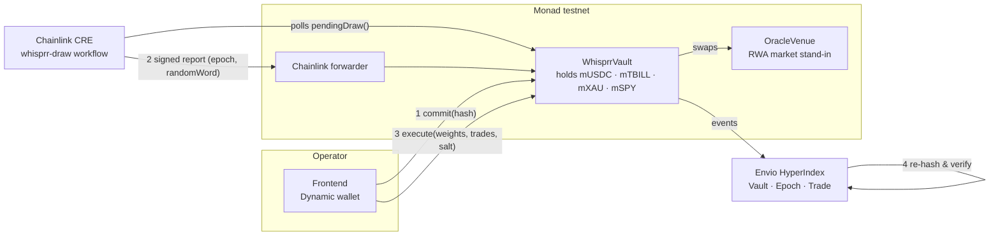

# Whisprr

**An onchain index whose rebalances can't be front-run.** Monad Metropolis Hackathon, Track 01: Onchain Finance & Trading.

The rules are public. The weights stay sealed until the block they execute in, and that block is drawn at random. Nobody can trade ahead of a rebalance they can't see.

## The problem: index funds pay to be predictable

An index publishes its reconstitution rules and rebalances on a known date. Everyone knows what it must buy and sell, and when, so the market positions ahead of it:

- **Dimensional** finds that index additions rise ~9 bps between the reconstitution announcement and the close as the index is forced to buy, then reverse ~13 bps afterwards. That round trip is paid by the index.
- **Arnott et al. (via Alpha Architect)** estimate that trading ahead of index funds, or delaying reconstitution by 3–12 months, can add up to **23 bps a year**. Discretionary deletions beat additions by 22% on average in the year after changes.
- **Greenwood, "The Disappearing Index Effect" (Harvard)** shows the effect has shrunk as markets adapted. Whisprr doesn't depend on it staying large: it removes the predictability that creates it.

## The fix: seal the specifics, randomize the timing

Whisprr keeps **the framework public** and **the actionable detail sealed**:

| Public from day one ([`docs/FRAMEWORK.md`](docs/FRAMEWORK.md), hash stored onchain) | Sealed until the moment of execution |
|---|---|
| The universe of constituents, the methodology class, the jitter window, the weight tolerance, the operator, the randomness source | The target weights, the trade list, the salt, and the exact execution time |

Each rebalance goes through four steps:

1. **Commit.** The operator posts `keccak256(abi.encode(chainid, vault, epoch, weights, trades, salt))` with a nominal date. Only the hash goes onchain.
2. **Draw.** A **Chainlink CRE** workflow delivers a DON-agreed random word. The vault mixes it with a block hash that didn't exist at commit time and draws the execution time uniformly inside `[nominal − jitterBefore, nominal + jitterAfter]`. Neither the market nor the operator can know the block in advance. If CRE doesn't deliver within ~80 seconds, anyone can draw from the block hash alone.
3. **Reveal + execute, atomically.** At the drawn time the operator submits the preimage. In **one transaction**, the vault checks it against the commitment, executes every trade against tokenized RWA constituents, and checks that the resulting weights match the committed targets within tolerance. The instructions are never public before they've executed.
4. **Verify.** Anyone can re-hash the revealed preimage from the `Executed` event. The frontend and the Envio indexer both do this independently. If the operator misses the grace period, anyone can flag the epoch as defaulted onchain.

There's no ZK here. A hash commitment is the right primitive: the methodology only needs to stay secret until it executes, not forever. One primitive covers both uses: the public framework is committed by hash at deployment, and each rebalance by hash before it executes.

### The jitter isn't a cost

Randomizing the date means filling at a slightly different price than the nominal date would have given. That difference is **zero-mean noise**: as likely to help as to hurt. Front-running drag is **one-directional**: it bleeds against the index on every rebalance.

<picture>
  <source media="(prefers-color-scheme: dark)" srcset="analysis/dispersion-dark.svg">
  
</picture>

Monte Carlo, 100,000 rebalances ([`analysis/dispersion.py`](analysis/dispersion.py)). Assumptions: 4 rebalances a year, 20% turnover each, a front-running premium of 22 ± 6 bps on traded notional (Dimensional's run-up plus reversal), Whisprr fills at a uniform offset of −1 to +2 days, 150 bps daily idiosyncratic volatility, 40 names per rebalance. Under those assumptions the transparent index loses **~17.6 bps a year**, in line with Arnott's 23 bps. Whisprr's expected cost is **zero**.

## Live on Monad testnet

| Contract | Address |
|---|---|
| `WhisprrVault` | [`0x4Ad9eE918aAAff5c00267af74A0590F5ED40ab2A`](https://testnet.monadexplorer.com/address/0x4Ad9eE918aAAff5c00267af74A0590F5ED40ab2A) |
| `OracleVenue` | [`0x2899bd7e163e537Cf3Eeae77BC75df5BB8469426`](https://testnet.monadexplorer.com/address/0x2899bd7e163e537Cf3Eeae77BC75df5BB8469426) |
| mUSDC · mTBILL · mXAU · mSPY | [`0xef9C…27c1`](https://testnet.monadexplorer.com/address/0xef9Cde1bd43c8b4d9d4e9D5e9a6740F0A81027c1) · [`0xB47e…d6da`](https://testnet.monadexplorer.com/address/0xB47ecD6C7f929881802d17eC179204a58f35d6da) · [`0xD6C1…44C7`](https://testnet.monadexplorer.com/address/0xD6C124c84B4E501Dd558d3D13C49f3f6338c44C7) · [`0xFA00…0ADD`](https://testnet.monadexplorer.com/address/0xFA00F349E7d55F795Cf54259f983289317000ADD) |

Rebalance #1, from sealed commitment to verified execution (25/25/25/25 → 10/40/20/30):

| Step | Transaction |
|---|---|
| 1. Commit: only `keccak256(preimage)` goes onchain | [`0xbfd5849c…6565382a`](https://testnet.monadexplorer.com/tx/0xbfd5849cef2a68944f1abc721a552446356bc3048b783c4b5dac248d6565382a) |
| 2. Draw: Chainlink CRE report sets the execution time (49 s before nominal) | [`0x126b9eaf…8128515f`](https://testnet.monadexplorer.com/tx/0x126b9eaf54d3f8663d865e664aa310a834ad4a72353306d89a343c018128515f) |
| 3. Reveal + execute: preimage checked, 3 trades, weights checked, in one tx | [`0x7bc9f791…1af51a35`](https://testnet.monadexplorer.com/tx/0x7bc9f791faf9b72e9488fa1cd56061cd0d1f3e2bc7f4033b30042eef1af51a35) |

The 18 deployment transactions are recorded in [`broadcast/Deploy.s.sol/10143/run-latest.json`](broadcast/Deploy.s.sol/10143/run-latest.json).

## Why it has to be fully onchain

A commit-reveal works even for an offchain index, but then it only proves *honesty of intent*. The buying and selling still happens where no one can see it. Whisprr's moat is that the whole mechanism runs onchain:

- the vault **holds** the constituents;
- the rebalance **executes** as chain-enforced transactions against them;
- the reveal is checked **in the same transaction** against the commitment and the resulting weights.

So the chain doesn't just record what the operator said it would do. It proves that exactly the committed rebalance happened, at a time nobody could have known in advance.

## Why Monad

Commit, draw, and execute are separate transactions, each racing the market. Monad's ~400 ms blocks and fast finality keep the window between commitment and execution tight and cheap, which makes the mechanism practical rather than theoretical. A jitter window measured in seconds or minutes on testnet maps to hours or days for a real reconstitution, without the chain becoming the bottleneck.

## Architecture



| Component | Path | Role |
|---|---|---|
| `WhisprrVault` | [`src/WhisprrVault.sol`](src/WhisprrVault.sol) | Holds constituents; commit → draw → atomic reveal + execute; CRE receiver; default flagging |
| `OracleVenue`, `MockRWA` | [`src/mocks/`](src/mocks) | Testnet RWA market and tokens (mUSDC cash, mTBILL, mXAU, mSPY) |
| CRE workflow | [`cre/`](cre) | Cron every 30s → `pendingDraw()` → DON randomness → signed report to the vault |
| Indexer | [`indexer/`](indexer) | Envio HyperIndex: one `Epoch` per rebalance with draw source, drawn offset from nominal, reveal, trades, and an independent `verified` re-hash |
| Frontend | [`frontend/`](frontend) | Vite + React + Dynamic: live vault, execution-window timeline, operator console, in-browser verification |
| Analysis | [`analysis/`](analysis) | Monte Carlo behind the chart above |

### Sponsor integrations

- **Chainlink CRE.** The `whisprr-draw` TypeScript workflow is the vault's randomness source. CRE's `Math.random()` is seeded per execution so every node agrees on the value. The vault accepts reports only from the configured forwarder, for the current epoch, once. It mixes in the draw block's hash so the DON's word alone doesn't decide the time, and opens the fallback only after a timeout, so the operator can't pick a source.
- **Envio.** HyperIndex turns raw events into the rebalance history the product is about: how long each rebalance stayed sealed, where the drawn time landed relative to nominal, which source drew it, and whether the reveal re-hashes to the commitment. The indexer computes that last check itself rather than trusting the contract.
- **Dynamic.** Sign-in with embedded or external wallets, used for more than login. The connected wallet's role decides what you can do: the operator gets the sealing console, while anyone signed in can trigger the fallback draw or flag a default, and everyone can verify.

## Run it

```bash
# contracts
forge build && forge test            # 26 tests

# deploy to Monad testnet (vault, venue, four RWAs, $1m seeded 25/25/25/25)
cp .env.example .env                  # PRIVATE_KEY with testnet MON
source .env
forge script script/Deploy.s.sol --rpc-url $MONAD_TESTNET_RPC --broadcast
```

Deploying writes `deployments/10143.json` and points the CRE workflow's config at the new vault. Then:

| What | Where |
|---|---|
| Randomness workflow | [`cre/README.md`](cre/README.md): `cre workflow simulate whisprr-draw -T staging-settings --broadcast` |
| Indexer | [`indexer/README.md`](indexer/README.md): `pnpm sync && pnpm dev` |
| Frontend | `cd frontend && cp .env.example .env` (set `VITE_DYNAMIC_ENV_ID`) `&& npm install && npm run dev`. In the Dynamic dashboard, enable **Monad Testnet** under Chains & Networks → EVM, or sign-in fails |

A rebalance can also be driven from the command line:

```bash
forge script script/Rebalance.s.sol --sig "commit()"  --rpc-url $MONAD_TESTNET_RPC --broadcast  # seal target weights
# the CRE workflow draws the time; if it isn't running, after ~200 blocks:
forge script script/Rebalance.s.sol --sig "draw()"    --rpc-url $MONAD_TESTNET_RPC --broadcast
forge script script/Rebalance.s.sol --sig "execute()" --rpc-url $MONAD_TESTNET_RPC --broadcast  # once executeAt passes
```

`commit()` keeps the preimage in `sealed/` (gitignored) and broadcasts only the hash. Target weights default to `1000,4000,2000,3000` bps; override them with `WEIGHTS=...`.

## Limitations

- **Testnet randomness path.** `cre workflow simulate --broadcast` writes through Monad testnet's *simulation* forwarder, which doesn't check DON signatures. The block-hash mix limits what a forged word can do, but a production vault should trust the **KeystoneForwarder** (`DRAW_FORWARDER=0xF8344CFd5c43616a4366C34E3EEE75af79a74482`). CRE's `Math.random()` is consensus-safe but not a CSPRNG.
- **Fallback reroll.** If the fallback draw's block falls out of the 256-block hash horizon, the draw re-arms to a fresh block. An operator who withholds the fallback call could wait for that reroll. With CRE running, the fallback is rarely needed.
- **Prices** come from an owner-set venue standing in for an RWA market. Pyth feeds would mark constituents to market.
- **Trades are planned at commit.** If prices move a lot before execution, the committed trades can miss the target weights by more than the tolerance and execution reverts. That makes the epoch defaultable rather than executing a different rebalance than the one committed.

## AI tools disclosure

This project was built with AI coding assistance, as required by the hackathon rules:

- **Claude Code** (Anthropic CLI agent, model: Claude Opus 5.5): scaffolding, Solidity contracts, tests, deploy scripts, the Chainlink CRE workflow, the Envio indexer, the React/Dynamic frontend, the Monte Carlo analysis and documentation, under the author's direction and review.
- **Claude** (claude.ai): design discussion and the build plan.

All code was written during the hackathon window.
